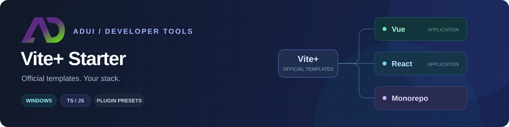

<p align="center">
  
</p>

<h1 align="center">ADui Vite+ Starter</h1>

<p align="center">
  基于 Vite+ 官方模板，按需组合你的前端技术栈。<br />
  Vue · React · TypeScript · JavaScript · Monorepo
</p>

<p align="center">
  <a href="#快速开始">快速开始</a> ·
  <a href="#安装后使用">安装与使用</a> ·
  <a href="#常用操作">常用操作</a> ·
  <a href="#项目结构">项目结构</a> ·
  <a href="#文档">文档</a> ·
  <a href="LICENSE">MIT</a>
</p>

> [!NOTE]
> **Windows CLI · v0.1.1**。包名 `@adui/viteplus-starter`，命令名 `viteplus-starter`；支持 Vite+、pnpm、npm、GitHub 和本地 tgz 入口。

## 功能

| 方向       | 支持能力                                                                                           |
| ---------- | -------------------------------------------------------------------------------------------------- |
| 官方工程   | Application / Monorepo；Vue 3 / React；TypeScript / JavaScript                                     |
| UI 与样式  | Vue：Element Plus、Ant Design Vue、TDesign；React：Ant Design、TDesign；CSS：UnoCSS / Tailwind CSS |
| 大屏与 3D  | AdScreen 大屏适配；Three.js / CesiumJS / Babylon.js，可多选、按需加载                              |
| 模型保护   | 自包含 GLB 自动加密为 `.adui`，内置或外置密钥模式，KEY 生成与轮换                                  |
| 工作区管理 | 逐应用添加、JSON 批量创建、只读检查与缺失应用恢复                                                  |
| 增量集成   | 已有应用补装、配置保护、可选独立验收页                                                             |

基础工程始终委托 Vite+ 官方 `vite:application` / `vite:monorepo`。各应用独立选择语言和插件，默认 TypeScript；UI、CSS 和引擎均可不启用。所有 Vue/React 应用默认导入本地静态 normalize.css，不安装 normalize.css npm 包。

新建应用、工作区默认网站、README 和 favicon 统一使用 [ADui Studio Logo](packages/create/assets/adui-studio-logo.svg)。应用首页与浏览器图标共用同一资源，生产构建由 Vite 处理路径。

## 快速开始

**环境**：Windows / PowerShell，Node.js `^22.18.0 || ^24.11.0 || >=26.0.0`，可运行的 Vite+ `vp` 与 pnpm。首次创建需要网络或完整的模板、依赖缓存。

### 1. 启动配置向导

**从 GitHub 下载。** 在项目父目录执行，工具目录 `viteplus-starter` 须不存在：

```powershell
vp create github:adui-dev/viteplus-starter
Set-Location -LiteralPath viteplus-starter
vp run create
```

也支持 `vp create https://github.com/adui-dev/viteplus-starter`。GitHub 命令下载生成器仓库，`vp run create` 才会启动配置向导，新应用与工具仓库并列生成。

**已有本地 tgz：直接运行。** 在项目父目录任选一种，替换为实际包路径：

```powershell
vp dlx -- 'C:\Downloads\adui-viteplus-starter-0.1.1.tgz'
# 或
pnpm dlx 'C:\Downloads\adui-viteplus-starter-0.1.1.tgz'
```

<details>
<summary>使用 npm 运行本地 tgz</summary>

```powershell
npm exec --yes --package 'C:\Downloads\adui-viteplus-starter-0.1.1.tgz' -- viteplus-starter
```

</details>

**按包名直接运行。** 以下三种方式任选一种，无需全局安装或添加项目依赖：

```powershell
vp dlx -- @adui/viteplus-starter
# 或
pnpm dlx @adui/viteplus-starter
# 或
npm exec --yes --package @adui/viteplus-starter -- viteplus-starter
```

### 2. 选择项目配置

向导依次选择名称、Application / Monorepo、框架、语言、UI、CSS、大屏、引擎及模型保护。

| 操作            | 按键                          |
| --------------- | ----------------------------- |
| 移动选项 / 确认 | 方向键 / Enter                |
| 多选 3D 引擎    | Space 勾选，Enter 确认        |
| 取消创建        | Ctrl+C，或在最终确认时选择 No |

### 3. 检查并启动应用

假设项目名为 `my-app`，根据入口进入对应目录：

| 创建入口                   | 项目位置         | 进入应用                              |
| -------------------------- | ---------------- | ------------------------------------- |
| 工具仓库内 `vp run create` | 工具仓库的父目录 | `Set-Location -LiteralPath ..\my-app` |
| dlx / 已安装的 CLI         | 当前调用目录     | `Set-Location -LiteralPath .\my-app`  |

```powershell
vp check
vp run build
vp dev
```

Monorepo 在工作区根运行 `vp run ready`。完整步骤见 [Windows 操作指南](docs/WINDOWS_GUIDE.md)。

## 安装后使用

也可以安装 CLI 长期使用。包名是 **`@adui/viteplus-starter`**，命令名是 **`viteplus-starter`**。

| 方式             | pnpm                                         | npm                                             |
| ---------------- | -------------------------------------------- | ----------------------------------------------- |
| 全局安装         | `pnpm add --global @adui/viteplus-starter`   | `npm install --global @adui/viteplus-starter`   |
| 全局安装后启动   | `viteplus-starter`                           | `viteplus-starter`                              |
| 项目内安装       | `pnpm add --save-dev @adui/viteplus-starter` | `npm install --save-dev @adui/viteplus-starter` |
| 项目内安装后启动 | `pnpm exec viteplus-starter`                 | `npm exec -- viteplus-starter`                  |

无参数启动向导，`--help` 查看帮助，`--dry-run` 只输出计划。CLI 是项目生成工具，无需在业务代码中 import；生成应用的日常开发继续使用 `vp`。

<details>
<summary>通过 vp dlx / pnpm dlx 传入帮助与预览参数</summary>

```powershell
vp dlx -- @adui/viteplus-starter --help
vp dlx -- @adui/viteplus-starter --name my-vue-app --type application --framework vue --ui element-plus --css tailwindcss --dry-run
pnpm dlx @adui/viteplus-starter --name my-vue-app --type application --framework vue --ui element-plus --css tailwindcss --dry-run
```

本地 tgz 使用同样的参数，只需将包名替换为 tgz 路径。`vp dlx --` 的分隔符让帮助等参数传给生成器。

</details>

## 常用操作

以下示例在**生成器仓库根目录**运行，目标按工具父目录解析。项目名以小写字母开头，只使用小写字母、数字和中划线；新建目标须不存在。

### 创建 Vue / React 应用

```powershell
# Vue + TypeScript + Element Plus + Tailwind CSS
vp run create --name my-vue-app --type application --framework vue --ui element-plus --css tailwindcss

# React + JavaScript + Ant Design + UnoCSS
vp run create --name my-react-app --type application --framework react --language js --ui antd --css unocss

# Vue 大屏 + Three.js，默认启用模型自动加密加载
vp run create --name my-screen --type application --framework vue --screen --engine three
```

添加 `--dry-run` 先预览；新建应用直接从正式 main/App 接入所选插件。默认不保留独立预设验收页，需要时添加 `--smoke-pages`。

<details>
<summary>创建 Monorepo，并添加独立配置的应用</summary>

```powershell
vp run create --name my-workspace --type monorepo
vp run create --workspace ./my-workspace --name admin --type application --framework vue --ui tdesign --css unocss
vp run create --workspace ./my-workspace --name portal --type application --framework react --language js --ui antd --css tailwindcss
```

保留官方 `apps/website` 和 `packages/utils`，新应用位于 `apps/<name>`。根不指定统一框架或语言。详见 [Monorepo 指南](docs/MONOREPO.md)。

</details>

<details>
<summary>使用 JSON 批量创建混合工作区</summary>

```powershell
vp run create --config ./viteplus-starter/examples/monorepo.batch.json --dry-run
vp run create --config ./viteplus-starter/examples/monorepo.batch.json
```

配置路径相对于工具父目录；工具目录重命名后须同步调整路径，或使用绝对路径。配置格式见 [批量配置](docs/BATCH_CONFIG.md)，更多组合见 [示例索引](examples/README.md)。

</details>

<details>
<summary>为已有 Vue 应用补装 UI / CSS</summary>

```powershell
vp run create --name existing-vue --type application --framework vue --ui element-plus --css tailwindcss --apply-existing
```

目标为工具父目录下的已有 `existing-vue`，框架和语言须匹配。本次新增插件统一归档；业务 App、挂载逻辑、自定义注册入口与配置原件备份保留，样式按已知规则增量导入。历史插件不自动迁移，冲突时停止并保留现场。详见 [补装接入说明](docs/PROJECT_LAYOUT.md)。

</details>

## 项目结构

只生成所选功能需要的目录。以 Vue TypeScript 应用为例：

```text
src/
├─ assets/         ADui Studio Logo 与应用资源
├─ plugins/        UI、大屏与所选引擎运行时
├─ components/     页面组件与按需场景入口
├─ styles/         本地 normalize.css、许可及首页样式
├─ models/         自包含 GLB，按模型保护配置生成
├─ App.vue         使用所选插件的正式首页
└─ main.ts         挂载、插件注册与样式入口
build/
└─ plugins/        模型加密、Cesium 静态资源等构建增强
```

Vue 在 main 注册插件、App 使用组件；React 保留 createRoot，在 App 组合组件。JS / React 使用对应的 JS / JSX / TSX 入口。引擎点击后加载，多引擎安装不会同时启动多个渲染器。详见 [目录与入口设计](docs/PROJECT_LAYOUT.md)。

模型保护默认将自包含 GLB 加密为 `.adui`，提供 `models:keygen` / `models:keyrotate`。客户端内置密钥用于提高直接复用门槛，不保证无法逆向提取，边界见 [模型构建指南](docs/MODEL_BUILD.md)。

## 文档

| 主题       | 指南                                                                                                                                                  |
| ---------- | ----------------------------------------------------------------------------------------------------------------------------------------------------- |
| 开始使用   | [Windows 操作](docs/WINDOWS_GUIDE.md) · [CLI 分发](docs/CLI_DISTRIBUTION.md) · [项目结构](docs/PROJECT_LAYOUT.md)                                     |
| 工作区     | [Monorepo](docs/MONOREPO.md) · [批量配置](docs/BATCH_CONFIG.md) · [配置示例](examples/README.md)                                                      |
| 大屏与引擎 | [AdScreen](docs/SCREEN.md) · [Three.js](docs/THREE_SMOKE.md) · [Cesium](docs/CESIUM.md) · [Babylon](docs/BABYLON.md) · [多引擎](docs/MULTI_ENGINE.md) |
| 模型与验收 | [模型构建](docs/MODEL_BUILD.md) · [模型加密](docs/MODEL_SECURITY.md) · [UI 验收](docs/UI_SMOKE.md)                                                    |
| 交付范围   | [当前能力](docs/GENERATOR_STATUS.md) · [验收范围](docs/V1_ACCEPTANCE.md) · [首发准备](docs/NPM_RELEASE.md)                                            |
| 开发维护   | [协作规范](AGENTS.md) · [架构](docs/ARCHITECTURE.md) · [代码索引](docs/CODEBASE_MAP.md) · [本地验证](docs/HARNESS.md)                                 |

当前验证覆盖 Windows 下的代表组合；完整构建、浏览器验收和未覆盖范围以验收文档为准。

<details>
<summary>本地开发与 CLI 打包</summary>

```powershell
git clone https://github.com/adui-dev/viteplus-starter.git
Set-Location -LiteralPath viteplus-starter
vp install --frozen-lockfile
node packages/create/bin/cli.mjs --help
node --test --test-concurrency=1
node scripts/validate-docs.mjs
vp check
```

在生成器根目录打包，再切换到项目父目录启动：

```powershell
$bundle = npm --silent run cli:pack | ConvertFrom-Json
if ($LASTEXITCODE -ne 0) { throw 'CLI 打包失败' }
Set-Location ..
vp dlx -- $bundle.tarball
```

打包结果包含 tgz 及内容清单。源码或包内 README 更新后须重新打包，旧 tgz 不会自动更新。直接调用 CLI 源文件时输出相对于当前调用目录；`vp run create` 始终以工具父目录为基准。详见 [CLI 分发说明](docs/CLI_DISTRIBUTION.md)。

</details>
