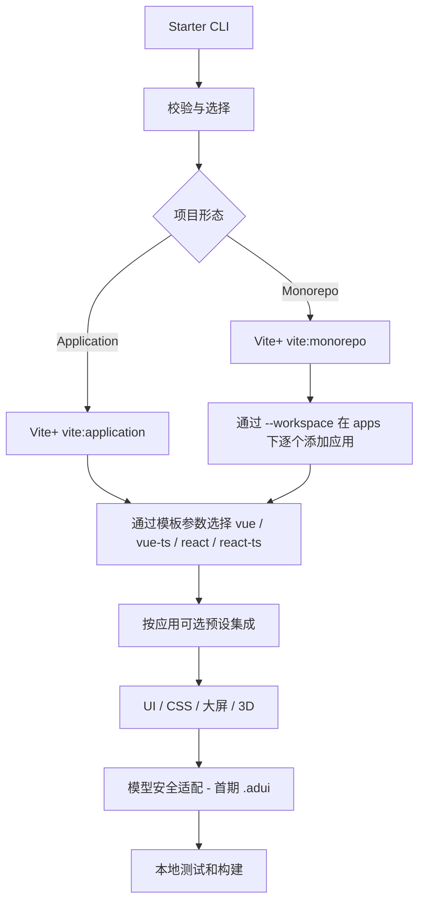

# 总体架构

## 原则

Vite+ 官方模板是**唯一基础工程来源**；ADui Starter 只负责交互、选项校验和按需增强。独立 Application 与 Monorepo 共享一套选项模型，插件按应用作用。

## 模块边界

- `packages/create`：CLI、配置校验、官方命令调用和 UI/CSS 应用集成；负责已实现的官方模板编排、按应用集成及独立验收入口。
- `packages/three` 提供引擎适配，`packages/model-security` 提供共享加解密源码与独立工具；生产授权服务尚未创建。
- `packages/cesium` 提供按需场景、实例生命周期与静态资源配置源码；create/engine 统一生成 Three/Cesium 计划，create/cesium 增量安装和配置，Cesium 暂不接入模型保护。
- `packages/babylon` 提供按需场景和 Engine/Scene 生命周期；create/babylon 增量安装依赖及四组合独立页面，无需修改 Vite 配置，暂不接入模型保护；create/engine 同时编排其计划。
- `scripts/validate-docs.mjs`：本地文档静态校验；不是 CI。
- 官方 Vite+ 负责应用模板、基础工具链；不得偷偷替换官方模板。
- `workspace.mjs` 预检已有官方 pnpm 根、成员路径与同名包；子应用仍交给 `vite:application`，以工作区根为 cwd，不传 Git 初始化参数。UI/CSS 安装在子应用中，官方管理共享锁文件和 catalog；Vue TS 声明格式忽略规则仅在根增量合并。
- `batch.mjs` 将严格 JSON 转成顺序阶段计划；根直接调用官方 `vite:monorepo`，应用和验收页通过 argv 子进程复用单应用 CLI，沿用路径保护与 UI/CSS 兼容处理；配置不提供自定义命令或脚本。
- 混合工作区的插件 peer 兼容修复在根 packageExtensions 增量记录，避免缺失 Vite peer 时从提升目录解析到另一应用的类型实例；拒绝覆盖冲突的用户配置。
- 模型安全：加密 CLI / 浏览器解密 / Loader 分离；当前无服务端方案由 env 提供构建密钥；embedded 与 external 的边界见 MODEL_BUILD，浏览器端保护不等于 DRM。

## 架构风险

1. UI/CSS 当前只适配已知的 Vite+ Vue/React 应用入口及插件数组，若官方模板结构变化需调整并复验。Vite+ 的 `vite:application` 在当前版本默认会生成普通 Vite；应用必须显式转发 `--template vue-ts|react-ts`，并在实际生成后检查框架依赖。
2. Monorepo 混合代表组合已实测，新增组合和依赖版本仍需生成后的实际验证。
3. Cesium 资源目录、Canvas 适配、外部模型贴图需专项测试。
4. 未安装依赖或无网络环境不能声称构建通过。
5. 禁止所有 CI/CD 工作流：仅提供本地验证命令和人工检查。

## 架构决策

[ADR-0001：官方 Vite+ 模板作为唯一基础来源](adr/0001-official-viteplus-templates.md)。

## P5：共享大屏核心

新增 packages/screen 作为框架无关核心与 Vue/React 适配器来源；生成器只向官方应用增量添加源码快照和独立验收页，不维护新的框架工程模板，也不修改正式页面。框架为可选 peer，不给应用引入另一框架。布局与引擎渲染生命周期分离，具体接口见 [SCREEN](SCREEN.md)。

## Three.js 首期

新增 packages/three：框架无关的独占场景运行时，依赖可选 Three peer；index 提供固定引擎绑定，runtime 注入引擎依赖以便受控验证初始化异常与清理。--three-smoke 只补充已有大屏应用，不另建框架模板，不修改官方正式入口。Three Smoke 的组件封装负责 Vue/React 生命周期；后续正式引擎选择与模型 Loader 另行扩展，详见 [THREE_SMOKE](THREE_SMOKE.md)。

## Three.js 应用选择与按需加载

应用创建选项支持 engine=none/three；CLI --engine three 与新建 --screen 配合，JSON 每应用独立配置，根不接受引擎。复用已有源码写入器及官方模板流程，现有首页不变。createLazyScene 将模块加载与 WebGL 生命周期分离；用户点击后动态导入引擎，不在应用/验收页初始化时创建 GPU 资源。引擎与框架自然分块，未修改用户构建配置。

## GLB 模型边界

model.mjs 独立处理自包含 GLB 预检、请求代次与返回资产的去重清理，runtime.mjs 负责挂载、模型包围盒/相机适配与查看器环境光；index.mjs 仅在选择模型时动态导入官方 GLTFLoader。UI 以本地 ArrayBuffer 传递，不硬编码用户路径或打包测试模型。模型授权与加解密由独立 model-security 核心和 lazy 前置适配负责；当前不推进服务端授权服务。

## .adui 模型封装

packages/model-security 独立于 Three/Vue/React，分离 Node 封装工具、浏览器 AES-GCM 核心和本地验收授权 provider。Three lazy 仅持有授权回调并将解密缓冲交给 GLB 运行时；无静态密钥或生产服务实现。生成器随引擎复制公共源码，不更改正式入口或 Vite 配置。服务端授权接口契约和边界见 [MODEL_SECURITY](MODEL_SECURITY.md)。

## 无服务端模型构建

按用户最终要求以防直接复用为目标，新增 Vite 插件在 Node 读取 env、扫描 GLB、生成 .adui；虚拟目录与运行时 key 模块分离。embedded 默认自动解密，采用每次构建随机掩码拆分和可选域名限制；external 才要求独立解锁文件。原始密钥字面量与模型明文均做产物检查，不把客户端混淆视为不可破解。详情见 [MODEL_BUILD](MODEL_BUILD.md)。

## 创建器模型集成

model-protection.mjs 将按应用的 modelProtection 选项映射到已有安全安装器和密钥生成器，不再通过用户手动分两步安装。Three 默认 embedded，明确 none 关闭，external 保留离线解锁。先预检 env/脚本/输出占用，再执行官方模板及增量集成；密钥只在执行阶段生成，dry-run 不含密钥。package 的 KEY 生成/备份轮换与按文件 IV 生成各自负责，不配置共享 IV。
