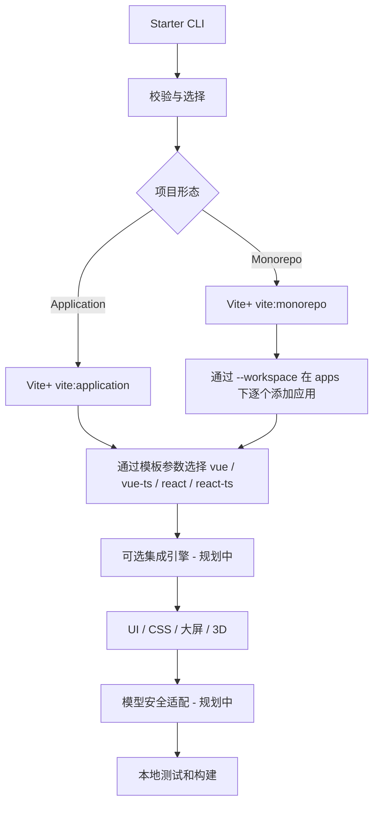

# 总体架构

## 原则

Vite+ 官方模板是**唯一基础工程来源**；ADui Starter 只负责交互、选项校验和按需增强。独立 Application 与 Monorepo 共享一套选项模型，插件按应用作用。

## 模块边界

- `packages/create`：CLI、配置校验、官方命令调用和 UI/CSS 应用集成；已建立最小实现。
- `packages/*` 未来可容纳共享模型加解密核心及引擎适配；尚未创建。
- `scripts/validate-docs.mjs`：本地文档静态校验；不是 CI。
- 官方 Vite+ 负责应用模板、基础工具链；不得偷偷替换官方模板。
- `workspace.mjs` 预检已有官方 pnpm 根、成员路径与同名包；子应用仍交给 `vite:application`，以工作区根为 cwd，不传 Git 初始化参数。UI/CSS 安装在子应用中，官方管理共享锁文件和 catalog；Vue TS 声明格式忽略规则仅在根增量合并。
- `batch.mjs` 将严格 JSON 转成顺序阶段计划；根直接调用官方 `vite:monorepo`，应用和验收页通过 argv 子进程复用单应用 CLI，沿用路径保护与 UI/CSS 兼容处理；配置不提供自定义命令或脚本。
- 混合工作区的插件 peer 兼容修复在根 packageExtensions 增量记录，避免缺失 Vite peer 时从提升目录解析到另一应用的类型实例；拒绝覆盖冲突的用户配置。
- 模型安全：加密 CLI / 浏览器解密 / Loader 分离；生产密钥由后端提供，浏览器端保护不等于 DRM。

## 架构风险

1. UI/CSS 当前只适配已知的 Vite+ Vue/React 应用入口及插件数组，若官方模板结构变化需调整并复验。Vite+ 的 `vite:application` 在当前版本默认会生成普通 Vite；应用必须显式转发 `--template vue-ts|react-ts`，并在实际生成后检查框架依赖。
2. Monorepo 中 Vue 与 React 应用隔离、配置合并需要生成后的实际验证。
3. Cesium 资源目录、Canvas 适配、外部模型贴图需专项测试。
4. 未安装依赖或无网络环境不能声称构建通过。
5. 禁止所有 CI/CD 工作流：仅提供本地验证命令和人工检查。

## 架构决策

[ADR-0001：官方 Vite+ 模板作为唯一基础来源](adr/0001-official-viteplus-templates.md)。
