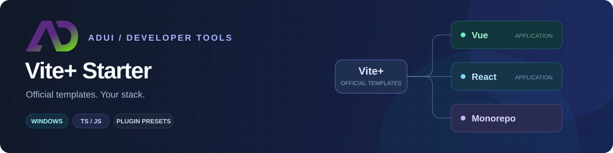

<p align="center">
  
</p>

<h1 align="center">ADui Vite+ Starter</h1>

<p align="center">
  基于 Vite+ 官方模板，按需组合 UI、CSS、大屏与 3D。<br />
  <a href="https://github.com/adui-dev/viteplus-starter">源码</a> ·
  <a href="https://github.com/adui-dev/viteplus-starter/blob/main/docs/WINDOWS_GUIDE.md">使用指南</a> ·
  <a href="https://github.com/adui-dev/viteplus-starter/issues">问题反馈</a>
</p>

> [!NOTE]
> **Windows CLI · v0.1.1**。通过 Vite+、pnpm 或 npm 启动配置向导，按需生成官方 Vue、React 与 Monorepo 工程。

## 快速开始

**环境**：Windows，Node.js `^22.18.0 || ^24.11.0 || >=26.0.0`，可运行的 Vite+ `vp` 与 pnpm。首次启动和创建需要网络或完整依赖缓存。

### 使用本地 tgz

从希望存放新项目的父目录任选一种命令，替换为实际 tgz 路径：

```powershell
vp dlx -- 'C:\Downloads\adui-viteplus-starter-0.1.1.tgz'
# 或
pnpm dlx 'C:\Downloads\adui-viteplus-starter-0.1.1.tgz'
```

<details>
<summary>使用 npm 运行本地 tgz</summary>

```powershell
npm exec --yes --package 'C:\Downloads\adui-viteplus-starter-0.1.1.tgz' -- viteplus-starter
```

</details>

### 通过包名直接运行

以下方式无需全局安装，也不将生成器添加到项目依赖：

```powershell
vp dlx -- @adui/viteplus-starter
# 或
pnpm dlx @adui/viteplus-starter
# 或
npm exec --yes --package @adui/viteplus-starter -- viteplus-starter
```

### 选择配置并启动应用

无参数进入向导，选择项目形态、Vue / React、TS / JS、UI、CSS、大屏、引擎与模型保护。方向键移动，Enter 确认；引擎用 Space 多选，Ctrl+C 取消。

项目生成在**当前调用目录**下，与 CLI 安装目录无关。以 `my-app` 为例：

```powershell
Set-Location -LiteralPath .\my-app
vp check
vp run build
vp dev
```

Monorepo 在工作区根运行 `vp run ready`。

## 安装后使用

包名 **`@adui/viteplus-starter`**，命令名 **`viteplus-starter`**。可任选一种方式安装：

| 方式             | pnpm                                         | npm                                             |
| ---------------- | -------------------------------------------- | ----------------------------------------------- |
| 全局安装         | `pnpm add --global @adui/viteplus-starter`   | `npm install --global @adui/viteplus-starter`   |
| 全局安装后启动   | `viteplus-starter`                           | `viteplus-starter`                              |
| 项目内安装       | `pnpm add --save-dev @adui/viteplus-starter` | `npm install --save-dev @adui/viteplus-starter` |
| 项目内安装后启动 | `pnpm exec viteplus-starter`                 | `npm exec -- viteplus-starter`                  |

生成器无需在 Vue/React 业务代码中 import；生成应用的日常开发继续使用 `vp`。

## 参数用法

全局安装后，可直接查看帮助、预览或创建项目：

```powershell
viteplus-starter --help
viteplus-starter --name my-vue-app --type application --framework vue --ui element-plus --css tailwindcss --screen --dry-run
```

去掉 `--dry-run` 即实际创建。项目名以小写字母开头，只使用小写字母、数字和中划线；新建目标须不存在。

<details>
<summary>使用 dlx 传入相同参数</summary>

```powershell
vp dlx -- @adui/viteplus-starter --help
vp dlx -- @adui/viteplus-starter --name my-vue-app --type application --framework vue --ui element-plus --css tailwindcss --screen --dry-run
pnpm dlx @adui/viteplus-starter --name my-vue-app --type application --framework vue --ui element-plus --css tailwindcss --screen --dry-run
```

本地 tgz 使用同样的参数，只需将包名替换为实际 tgz 路径。`vp dlx --` 的分隔符确保帮助等参数传给生成器。npm 对应 `npm exec --yes --package @adui/viteplus-starter -- viteplus-starter --help`。

</details>

| 选项                         | 可用值 / 用途                                                     |
| ---------------------------- | ----------------------------------------------------------------- |
| `--type`                     | `application` / `monorepo`                                        |
| `--framework` / `--language` | `vue` / `react`；`ts` / `js`，默认 TypeScript                     |
| `--ui`                       | `none` / `element-plus` / `antd` / `tdesign`；Element Plus 仅 Vue |
| `--css`                      | `none` / `unocss` / `tailwindcss`                                 |
| `--screen`                   | 启用 AdScreen 大屏适配                                            |
| `--engine` / `--engines`     | 单引擎或逗号分隔的 `three,cesium,babylon`，两个选项互斥           |
| `--model-protection`         | `embedded` / `external` / `none`，选择引擎后默认 `embedded`       |
| `--workspace` / `--config`   | 向已有官方工作区添加应用 / 按 JSON 批量创建                       |
| `--apply-existing`           | 为已有匹配框架、语言的应用补装                                    |
| `--smoke-pages`              | 额外保留本次预设独立验收页                                        |

Monorepo 根不指定框架、语言或插件，各应用独立配置。全部参数以 `--help` 为准。

## 生成结果

新建 Vue/React 应用（含无插件应用）、工作区默认网站、验收页图标与 README 统一使用 ADui Studio Logo。首页与 favicon 共用 src/assets/adui-studio-logo.svg，由 Vite 处理生产资源路径；已有业务项目的自定义标识不自动覆盖。

| 内容             | 默认行为                                                                   |
| ---------------- | -------------------------------------------------------------------------- |
| 基础工程         | 委托 Vite+ 官方 `vite:application` / `vite:monorepo`                       |
| 运行时与构建插件 | 分别集中到 `src/plugins` / `build/plugins`，新建时接入正式 main/App        |
| 基础样式         | 导入本地静态 normalize.css，不安装 normalize.css npm 包                    |
| 场景与验收页     | 引擎按需启动；独立预设页默认不保留，`--smoke-pages` 可额外保留             |
| 已有应用补装     | 归档本次新增插件，保留业务首页、自定义注册逻辑与配置原件备份，样式增量导入 |

模型保护将自包含 GLB 转为 `.adui`，提供 KEY 生成与轮换脚本。客户端内置密钥用于提高直接复用门槛，不保证无法逆向提取。

## 文档

| 主题       | 入口                                                                                                                                                                                       |
| ---------- | ------------------------------------------------------------------------------------------------------------------------------------------------------------------------------------------ |
| 使用与接入 | [Windows 指南](https://github.com/adui-dev/viteplus-starter/blob/main/docs/WINDOWS_GUIDE.md) · [目录与补装](https://github.com/adui-dev/viteplus-starter/blob/main/docs/PROJECT_LAYOUT.md) |
| 批量与模型 | [批量配置](https://github.com/adui-dev/viteplus-starter/blob/main/docs/BATCH_CONFIG.md) · [模型构建](https://github.com/adui-dev/viteplus-starter/blob/main/docs/MODEL_BUILD.md)           |
| 分发与范围 | [CLI 分发](https://github.com/adui-dev/viteplus-starter/blob/main/docs/CLI_DISTRIBUTION.md) · [验收范围](https://github.com/adui-dev/viteplus-starter/blob/main/docs/V1_ACCEPTANCE.md)     |

<details>
<summary>从源码生成本地 CLI 包</summary>

在生成器仓库根目录安装依赖后执行：

```powershell
$bundle = npm --silent run cli:pack | ConvertFrom-Json
if ($LASTEXITCODE -ne 0) { throw 'CLI 打包失败' }
$bundle.tarball
```

产物提供 tgz 绝对路径和独立内容清单，随包携带 MIT LICENSE 与 normalize.css 原许可。源码或包内 README 更新后须重新打包。GitHub 下载模式则在工具目录运行 `vp run create`，在工具父目录生成应用。

</details>
